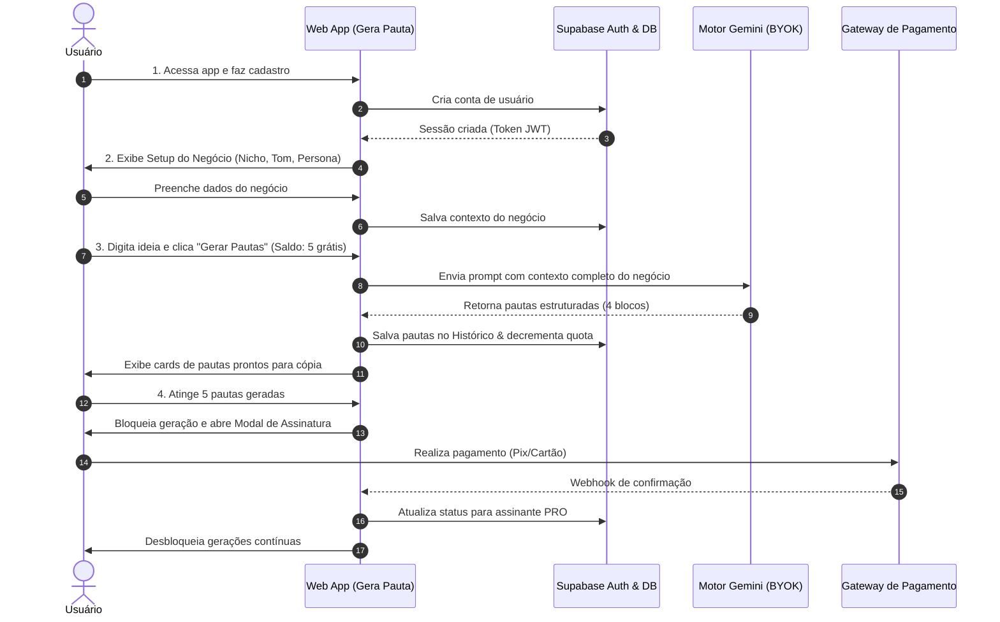

# 📋 PRD — Gera Pauta (Gerador de Pautas Contextualizadas para Redes Sociais)

**Versão:** 2.0 (Transição para SaaS Comercial B2B / Pequenos Negócios)  
**Prazo de Entrega do MVP:** 10 dias corridos  
**Stack Base:** Next.js (App Router) + React 19 + TypeScript + Tailwind CSS + Google Gemini AI + Supabase (Auth/Postgres) + Gateway de Pagamentos  

---

## 1. Visão Geral

- **Nome do produto:** **Gera Pauta**
- **Elevator pitch:**  
  O **Gera Pauta** é uma plataforma web que gera pautas completas e estratégicas para redes sociais (Mote criativo, Headline da arte, Legenda persuasiva e Formato ideal), profundamente ancoradas no contexto real do negócio do cliente — seu nicho, tom de voz, dores e personas específicas. Diferente de chats genéricos de IA, entrega em menos de 10 segundos conteúdos prontos para produção sem necessidade de engenharia de prompt complexa.
- **Objetivo do MVP:**  
  Entregar um web app comercial com autenticação, onde microempresas, profissionais liberais e pequenas agências possam cadastrar o contexto do seu negócio (ou múltiplos clientes), gerar até 5 pautas gratuitas para testar o valor real da ferramenta e assinar um plano pago para desbloquear gerações recorrentes e gestão contínua de conteúdo.

---

## 2. Personas

### Persona 1: Dra. Camila — Profissional Liberal / Pequena Empresa Local
- **Perfil:** 33 anos, dona de consultório odontológico em cidade média. Cuida do atendimento clínico, gestão financeira e precisa alimentar o Instagram da clínica toda semana.
- **Dores principais:**
  - Não tem orçamento para pagar R$ 1.500/mês a uma agência de marketing ou social media dedicado.
  - Tenta usar o ChatGPT, mas recebe ideias genéricas ("Poste sobre a importância de escovar os dentes"), que soam artificiais e não convertem pacientes particulares.
  - Perde horas com o "bloqueio da folha em branco" toda semana.
- **O que quer alcançar:** Digitar uma oferta ou novidade da sua clínica e receber imediatamente pautas com tom profissional, quebrando as dúvidas e medos reais dos seus pacientes.
- **Como descobriria o produto:** Anúncio no Instagram ("Cansado de ideias genéricas do ChatGPT para sua clínica?") ou indicação em grupos locais de empreendedores.

### Persona 2: Lucas — Dono de Microagência / Social Media Freelancer
- **Perfil:** 27 anos, atende de 4 a 8 clientes locais simultaneamente (hamburgueria, escritório de advocacia, loja de roupas, contabilidade).
- **Dores principais:**
  - Precisa criar dezenas de pautas por semana em nichos completamente diferentes.
  - O ChatGPT mistura os contextos dos clientes se não passar prompts gigantescos todas as vezes.
  - Sofre com alterações constantes de clientes porque a pauta não respeitou o tom de voz da marca.
- **O que quer alcançar:** Cadastrar cada cliente em um workspace individual (com seu tom de voz, público e diferencial) e gerar calendários semanais de conteúdo em minutos.
- **Como descobriria o produto:** Comunidades de Social Media no WhatsApp/Discord, reels de criadores de conteúdo sobre produtividade ou busca no Google ("gerador de pauta para clientes de agência").

---

## 3. User Stories Priorizadas (MoSCoW)

### 🔴 Must Have (Obrigatório para o MVP funcionar em 10 dias)
- **US-01:** Como **novo usuário**, eu quero **me cadastrar com e-mail/senha ou Google** para **acessar minha conta e salvar meu histórico com segurança**.
- **US-02:** Como **usuário**, eu quero **cadastrar o perfil do meu negócio (ou cliente)** com nome, nicho de atuação, tom de voz e personas/público-alvo para **que a IA gere conteúdos fiéis à realidade da empresa**.
- **US-03:** Como **usuário**, eu quero **selecionar a Rede Social de destino (Instagram, LinkedIn, WhatsApp, TikTok) e o Objetivo de Conversão (WhatsApp, Comentários, Salvamentos ou Vendas)** para **que a pauta venha calibrada para o canal certo com a CTA exata**.
- **US-04:** Como **usuário**, eu quero **digitar uma ideia livre, novidade ou selecionar um ângulo pré-definido** para **gerar pautas estruturadas (Mote, 2 Opções de Headline de Arte, Legenda com CTA configurável e Formato Recomendado)**.
- **US-05:** Como **usuário**, eu quero **ativar ou desativar emojis e hashtags sugeridas com um clique** para **adequar o visual da legenda à sobriedade da minha área de atuação**.
- **US-06:** Como **usuário gratuito**, eu quero **gerar até 5 pautas gratuitas** para **avaliar a eficácia do conteúdo antes de pagar**.
- **US-07:** Como **usuário**, eu quero **poder ajustar/refazer uma pauta específica com 1 clique informando o que desejo mudar** para **lapidar a redação sem perder o lote**.
- **US-08:** Como **usuário**, eu quero **ter um histórico permanente de pautas geradas** para **consultar, copiar e reaproveitar conteúdos anteriores**.
- **US-09:** Como **usuário**, eu quero **assinar um plano pago via Pix ou Cartão de Crédito** para **continuar gerando pautas após atingir o limite gratuito**.
- **US-10:** Como **usuário pagante**, eu quero **inserir minha chave de API do Google Gemini (BYOK)** para **ativar gerações ilimitadas sem custos ocultos de infraestrutura de IA**.

### 🟡 Should Have (Importante, mas entra no sprint seguinte se necessário)
- **US-09:** Como **social media (Lucas)**, eu quero **cadastrar múltiplos clientes/marcas em abas separadas** para **gerenciar carteiras distintas na mesma conta**.
- **US-10:** Como **usuário**, eu quero **exportar a lista de pautas geradas em formato TXT/Markdown ou CSV** para **enviar ao cliente ou designer**.
- **US-11:** Como **usuário**, eu quero **favoritar as melhores pautas no histórico** para **facilitar o acesso rápido**.

### 🟢 Could Have (Desejável para versões futuras)
- **US-12:** Como **usuário**, eu quero **subir uma planilha de clientes/seguidores para extrair automaticamente interesses e dados demográficos**.
- **US-13:** Como **usuário**, eu quero **visualizar um calendário mensal visual das pautas geradas**.

### ⚪ Won't Have (Explicitamente FORA do escopo do MVP de 10 dias)
- **US-14:** Geração e renderização de artes em PNG, vídeos ou carrosséis prontos dentro da ferramenta.
- **US-15:** Agendamento ou publicação automática em redes sociais (API Meta/Instagram/LinkedIn).
- **US-16:** Login de equipe com diferentes níveis de permissão dentro do mesmo workspace.
- **US-17:** Sistema complexo de medição de engajamento pós-publicação.

---

## 4. Features do MVP (Apenas as Must Have)

### Feature 1: Autenticação & Gestão de Conta (Supabase Auth)
- **Descrição:** Cadastro e login via e-mail e senha com suporte a recuperação de credenciais e isolamento de dados por usuário.
- **Critérios de aceitação:**
  - [ ] Usuário consegue criar conta com e-mail válido e senha segura em menos de 30 segundos.
  - [ ] Sessão persistida com JWT seguro; rotas protegidas redirecionam visitantes não autenticados.
- **Dependências:** Nenhuma.

### Feature 2: Onboarding de Contexto do Negócio (Setup do Perfil/Cliente)
- **Descrição:** Formulário intuitivo de onboarding onde o usuário define: Nome da Marca, Nicho/Segmento, Tom de Voz (ex: Formal, Descontraído, Educativo, Inspirador), Público-Alvo/Persona (Dores, Desejos e Objeções) e Diferenciais Competitivos.
- **Critérios de aceitação:**
  - [ ] Ao concluir o onboarding, o perfil fica gravado no banco de dados e pode ser editado a qualquer momento.
  - [ ] Os dados desse perfil são injetados automaticamente em todas as requisições de IA para personalizar as pautas.
- **Dependências:** Feature 1 (Autenticação).

### Feature 3: Motor de Pautas Contextualizadas & Multicanal (Arquitetura Híbrida)
- **Descrição:** Interface de geração onde o usuário seleciona a Rede Social (Instagram, LinkedIn, WhatsApp, TikTok), o Objetivo de Conversão (WhatsApp, Comentários, Salvamentos ou Vendas), insere a ideia inicial/novidade e ajusta toggles rápidos de Emojis e Hashtags. O motor devolve cards estruturados com os 4 blocos de entrega e 2 variações de headline da arte.
- **Arquitetura de Inteligência em 2 Níveis:**
  - **Nível 1 (Motor Padrão do Sistema / Grátis):** As 5 pautas de degustação são processadas via API de LLM na nuvem de alta capacidade (Llama 3.3 70B via Groq ou Gemini 2.5 Flash Free Tier do sistema), garantindo linguagem humana, persuasiva e contextualizada — banindo templates fixos ou textos robotizados.
  - **Nível 2 (Potencializador PRO / Chave do Usuário - BYOK):** O usuário pode conectar sua própria chave de API (Google AI Studio Gemini ou OpenAI) para liberar limites maiores e escolher modelos mais avançados.
- **Critérios de aceitação:**
  - [ ] Todo conteúdo retornado contém obrigatoriamente: (1) Mote Estratégico, (2) Duas opções de Headline de Arte (ex: Pergunta Provocativa vs. Afirmação de Impacto), (3) Legenda Completa com CTA customizado e (4) Formato Recomendado com Justificativa.
  - [ ] Seletor de canal adapta os limites e o tom automaticamente (ex: texto mais curto e dinâmico para Reels/TikTok, mais corporativo para LinkedIn).
  - [ ] Toggles para ligar/desligar emojis e hashtags funcionam em tempo real.
  - [ ] Botão "Copiar" individual com feedback visual (toast).
  - [ ] Opção de "Refazer / Ajustar" pauta individual com instrução em texto livre.
- **Dependências:** Feature 2 (Contexto do Negócio).

### Feature 4: Controle de Quota Gratuita (5 Pautas Grátis)
- **Descrição:** Contador no dashboard que monitora a quantidade de pautas geradas. Ao atingir 5 pautas no plano gratuito, bloqueia novas gerações e abre o modal de planos.
- **Critérios de aceitação:**
  - [ ] Usuário recém-cadastrado possui saldo de 5 pautas de degustação usando o motor de IA inteligente do sistema.
  - [ ] Ao tentar gerar a 6ª pauta, o sistema bloqueia no backend e exibe a tela de contratação de plano.
- **Dependências:** Feature 1 e Feature 3.

### Feature 5: Potencializador com Chave de IA do Usuário (BYOK — Bring Your Own Key) & Resiliência
- **Descrição:** Painel nas configurações onde o usuário pode cadastrar sua chave gratuita do Google AI Studio (Gemini) ou OpenAI. A chave do usuário potencializa o motor com autonomia total e gerações sem limite da cota do servidor. Possui motor de resiliência e fallback para garantir entrega contínua.
- **Critérios de aceitação:**
  - [ ] Usuário consegue colar sua chave de API, salvar no banco criptografada e testar a conexão com 1 clique.
  - [ ] Passo a passo ilustrado ensinando a obter a chave gratuita no Google AI Studio em menos de 1 minuto.
  - [ ] Sistema alterna de forma transparente entre o motor do sistema e a chave do usuário quando ativada.
- **Dependências:** Feature 1.

### Feature 6: Checkout & Assinatura de Planos (Stripe / Asaas)
- **Descrição:** Integração com gateway de pagamentos (Stripe para Cartão ou Asaas para Pix) para assinatura mensal do serviço.
- **Critérios de aceitação:**
  - [ ] Página de Planos com Checkout transparente ou redirect seguro.
  - [ ] Webhook de confirmação de pagamento atualiza o status do usuário para `ativo` e libera gerações ilimitadas imediatamente.
- **Dependências:** Feature 1 e Feature 4.

### Feature 7: Histórico Persistente de Pautas
- **Descrição:** Aba com listagem de todas as pautas criadas pelo usuário, com busca por palavra-chave, data e opção de exclusão.
- **Critérios de aceitação:**
  - [ ] Pautas geradas são salvas automaticamente no banco PostgreSQL do Supabase.
  - [ ] Carregamento paginado ou filtrável sem perda de histórico ao deslogar ou trocar de dispositivo.
- **Dependências:** Feature 1 e Feature 3.

---

## 5. Fluxos Principais

---

## 6. Regras de Negócio

1. **RN-01 (Limite do Plano Gratuito):** Cada nova conta cadastrada tem direito estrito a **5 pautas geradas**. O decremento ocorre por pauta produzida com sucesso.
2. **RN-02 (Isolamento RLS):** Nenhum usuário pode ter visibilidade ou acesso às pautas, dados de negócio ou chave de API de outro usuário.
3. **RN-03 (Estrutura Mandatória de Conteúdo):** Toda pauta deve retornar obrigatoriamente: Mote, Headline de Arte, Legenda com CTA e Formato com Justificativa estratégica.
4. **RN-04 (Arquitetura Híbrida de IA & Modelo BYOK):** O sistema utiliza o Motor Gratuito da plataforma (Llama 3.3 70B via Groq ou Gemini 2.5 Flash Free Tier) para processar as 5 pautas de degustação com alta inteligência. O usuário tem a opção de inserir sua própria chave de API (BYOK - Google Gemini ou OpenAI) para potencializar o motor com autonomia total e gerações ilimitadas. O modelo de receita é a assinatura do software, com custo de IA zero para a plataforma.
5. **RN-05 (Liberação Imediata via Webhook):** Ao receber o evento de confirmação de pagamento (`payment_intent.succeeded` ou `PAYMENT_RECEIVED`), a conta do usuário deve ser atualizada para `status = 'pro'` em menos de 5 segundos.
6. **RN-06 (Refazer Pauta):** O refinamento ("Refazer Pauta") atualiza o registro no histórico mantendo a versão anterior disponível para restauração.

---

## 7. Fora do Escopo (O que NÃO estará no MVP)

- Editor visual drag-and-drop de imagens ou integração com Canva API.
- Publicação ou agendamento direto em contas de redes sociais.
- Multi-usuários corporativos dentro da mesma empresa (compartilhamento de logins).
- Aplicativo mobile nativo (iOS/Android) — o produto será uma Progressive Web App (PWA) / web responsiva otimizada para mobile e desktop.
- Integração direta com CRMs externos (RD Station, HubSpot, etc.).

---

## 8. Requisitos Não-Funcionais

- **Performance:** Carregamento inicial da aplicação em menos de 1.5s; geração de pautas estruturadas pela IA em 3 a 8 segundos.
- **Segurança:** Chaves de API do usuário criptografadas em repouso no banco; todas as rotas protegidas por autenticação via JWT e regras de Row Level Security (RLS).
- **Acessibilidade:** Conformidade básica WCAG 2.1 AA (contraste mínimo de 4.5:1, foco visível pelo teclado, sem bloqueio de zoom).
- **Compatibilidade:** Suporte aos navegadores modernos (Chrome, Edge, Safari, Firefox) no Desktop e Mobile (iOS Safari e Android Chrome).
- **LGPD:** Nenhuma informação sensível além do e-mail de autenticação e dados comerciais declarados pelo próprio usuário é coletada. Não há coleta de dados de terceiros sem consentimento.

---

## 9. Métricas de Sucesso do MVP (Após 10 Dias de Lançamento)

1. **Aquisição:** 100 usuários cadastrados nos primeiros 14 dias pós-lançamento.
2. **Ativação:** 70% dos usuários cadastrados gerando pelo menos 3 pautas no plano gratuito.
3. **Conversão Comercial:** No mínimo 5% dos usuários que atingirem o limite gratuito (5 pautas) convertendo para o plano pago.
4. **Satisfação:** Tempo médio de geração e cópia de uma pauta inferior a 2 minutos.

---

## 10. Decisões Técnicas Iniciais

- **Precisa de banco de dados?** **Sim.** PostgreSQL hospedado no **Supabase** para armazenar usuários, perfis de negócio, chaves BYOK e histórico de pautas.
- **Precisa de autenticação/login?** **Sim.** **Supabase Auth** (E-mail/Senha + Google OAuth).
- **Precisa de pagamentos?** **Sim.** **Stripe** (Cartão de crédito global) ou **Asaas** (Pix nativo para o Brasil).
- **Vai publicar na internet?** **Sim.** Deploy contínuo na **Vercel** conectado ao repositório GitHub, com HTTPS automático.