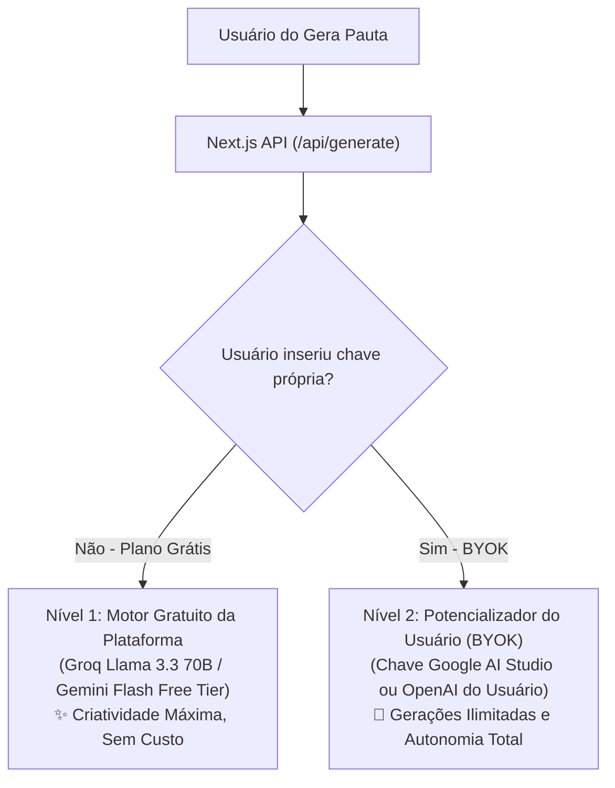
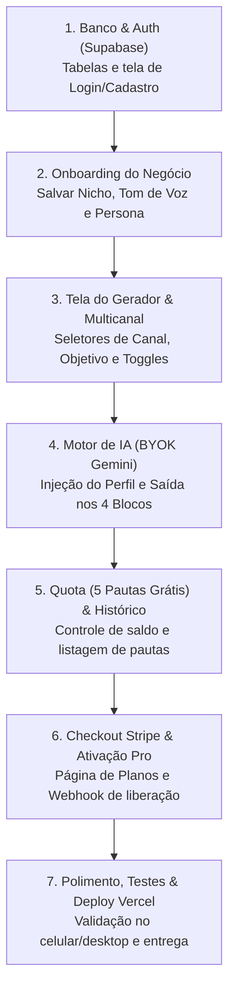

# 🛠️ TECH STACK & ARQUITETURA — Gera Pauta (SaaS MVP)

> **Para quem é este documento?**  
> Este guia foi escrito para você que é **web designer ou criador visual** e quer entender a arquitetura do seu produto sem "tecniquês" ou jargões complicados. Cada decisão técnica aqui foi pensada para ser tão clara quanto montar blocos de LEGO ou criar componentes reutilizáveis no Figma.

---

## 1. Stack Frontend (A "Vitrine" e o Cérebro do App)

### 🏆 Escolha Recomendada: **Next.js 15 (App Router) com React 19**

#### Por que essa escolha se encaixa no PRD do Gera Pauta?
No nosso PRD, o **Gera Pauta** não é só uma tela estática: ele precisa de uma página inicial bonita para apresentar a ferramenta ao visitante, telas protegidas por login para o cliente logado, conexão segura com o banco de dados (Supabase) e comunicação confidencial com a IA do Google Gemini e o gateway de pagamento (Stripe).

O **Next.js** é como um *"React com superpoderes"*: ele junta o **Frontend** (as telas interativas que o usuário vê) e o **Backend** (o servidor nos bastidores que protege senhas e chaves secretas) dentro do **mesmo projeto**. Você não precisa criar dois projetos separados nem configurar servidores complexos.

#### Quais trade-offs (concessões) estamos aceitando?
- **Pró:** Segurança absoluta para as chaves de API da IA, facilidade para criar páginas públicas (Landing Page) e rotas privadas protegidas, e deploy com 1 clique na Vercel.
- **Contra (Trade-off):** Diferente de um arquivo `.html` puro que você abre clicando duas vezes, o Next.js precisa que você rode o comando `npm run dev` no terminal para visualizar no seu navegador em `http://localhost:3000`.

#### Versões Recomendadas
- **Node.js:** `v20 LTS` ou `v22 LTS` (já instalado na sua máquina).
- **Next.js:** `15.x` ou `16.x` (App Router).
- **React:** `19.x`.
- **TypeScript:** `5.x` (funciona como um "corretor ortográfico" do código, avisando se você esquecer um campo obrigatório antes de salvar).

#### O que você precisa instalar para usar essa stack?
1. **Node.js** (já instalado no seu computador).
2. **VS Code / Editor de Código** (que você já está usando).
3. As bibliotecas são baixadas automaticamente com um único comando: `npm install`.

---

## 2. Estilização (O Visual e Design System)

### 🏆 Escolha Recomendada: **Tailwind CSS + shadcn/ui**

#### Por que essas escolhas? (Explicado para Designers)
- **Tailwind CSS:** Em vez de você criar um arquivo `.css` separado gigante de 2.000 linhas e ficar indo e voltando para lembrar nomes de classes, o Tailwind permite estilizar direto na tag HTML usando nomes fáceis e previsíveis (como `bg-indigo-600` para cor de fundo, `rounded-xl` para cantos arredondados, `p-6` para espaçamento interno). É idêntico a configurar **Auto Layout, Raio de Borda e Cores no Figma**, só que direto no código!
- **shadcn/ui:** É uma coleção de componentes profissionais prontos (botões, janelas modais, abas, campos de formulário, cards e menus) que já vêm com **acessibilidade de fábrica** (funcionam pelo teclado, atendem normas de contraste e leitores de tela). Os componentes são copiados para a sua pasta `src/components/ui`, ou seja, o código é 100% seu e você pode trocar as cores e estilos quando quiser.

---

## 3. Motor de Inteligência Artificial (Arquitetura Híbrida: Nuvem Gratuita + Potencializador BYOK)

### 💡 Por que NÃO rodar um script Python com modelo local no servidor?
- **O que seria isso:** Rodar bibliotecas como *Ollama* ou *llama-cpp-python* direto no computador do servidor.
- **Por que isso inviabilizaria o MVP comercial:**
  1. **Custo astronômico de servidor:** Para rodar uma IA minimamente inteligente em Python no servidor, você precisaria alugar uma máquina com GPU (placa de vídeo pesada) na AWS/RunPod que custa entre **R$ 400 a R$ 1.500 por mês**.
  2. **Incompatível com a Vercel:** A Vercel (onde hospedamos o Next.js gratuitamente) trabalha com funções leves (*serverless*) e não aguenta carregar modelos pesados de 8GB em memória.
  3. **No celular do cliente não roda:** O cliente usa o sistema pelo navegador do celular ou do notebook dele.

### 🏆 A Solução Inteligente Adotada: Motor Híbrido em 2 Níveis



1. **Nível 1 — Motor Gratuito da Plataforma (Degustação de 5 pautas inteligentes):**
   - Utilizamos APIs na nuvem de altíssima performance e **custo R$ 0,00** para o desenvolvedor:
     - **Groq API com Llama 3.3 70B:** Processa pautas em menos de 1 segundo com redação persuasiva nível agência internacional (grátis no free tier da Groq).
     - **Google Gemini 2.5 Flash (Free Tier):** Até 1.500 requisições diárias gratuitas pelo Google AI Studio.
   - **Adeus templates "burrinhos":** As 5 pautas de degustação já saem com linguagem humana e contextualizadas para o nicho do cliente.
2. **Nível 2 — Potencializador com Chave do Usuário (BYOK - Bring Your Own Key):**
   - O usuário tem um campo fácil nas configurações onde pode colar sua própria chave de API do **Google AI Studio** ou **OpenAI**.
   - Isso dá a ele autonomia ilimitada e **isenta a sua plataforma de pagar por faturas de IA**.

---

## 4. Backend e Banco de Dados (Onde as Informações Moram)

> **O que é "Backend" e "Banco de Dados" em 2 linhas?**  
> O **Backend** é a "cozinha nos bastidores" que processa regras com segurança (conecta na IA, valida pagamentos e confere senhas); e o **Banco de Dados** é a "despensa organizada" onde dados de login, perfis das empresas e histórico de pautas ficam salvos para nunca sumirem.

### 🏆 Escolha Recomendada: **Supabase (PostgreSQL + Row Level Security)**

Como o PRD exige **login de usuários, limites de 5 pautas gratuitas e salvamento de histórico**, precisamos de um banco de dados real na nuvem.
- **Por que o Supabase?** Ele entrega um banco de dados profissional (**PostgreSQL**) na nuvem de forma gratuita, com um painel visual lindo (parecido com uma planilha do Notion/Airtable) onde você pode ver e editar suas tabelas com cliques.
- **Segurança com RLS (Row Level Security):** O Supabase possui uma trava de segurança no banco que impede matematicamente que a "Dra. Camila" veja as pautas ou os dados do "Lucas". Cada usuário só enxerga o que é dele.
- *(Você seguirá o **Anexo A** do tutorial para configurar suas credenciais do Supabase).*

---

## 5. Autenticação (Login e Controle de Acesso)

> **O que é autenticação?**  
> É o "crachá de entrada" do seu sistema: a tela de e-mail e senha que garante que apenas a pessoa dona daquela conta consiga entrar e ver seus dados.

### 🏆 Escolha Recomendada: **Supabase Auth**
- O próprio Supabase já traz o sistema completo de login por **E-mail/Senha** e **Login com Google** pronto, com recuperação de senha e geração de chaves seguras (JWT).
- Redireciona automaticamente quem não está logado para a página de login quando tenta acessar `/dashboard`.

---

## 6. Pagamentos (Cobrança Online e Planos)

> **O que é um gateway de pagamento?**  
> É a "maquininha de cartão virtual" segura que processa cartões de crédito e Pix na internet, repassando o dinheiro para sua conta e avisando o seu sistema no mesmo segundo que a compra foi aprovada.

### 🏆 Escolha Recomendada: **Stripe** *(Alternativa nacional: Asaas)*
- Para o MVP comercial, o **Stripe** é o padrão mundial mais seguro, com tela de pagamento pré-pronta (*Stripe Checkout*) que já calcula impostos e aceita cartão com zero dor de cabeça.
- O sistema escuta um "aviso automático" (*Webhook*) do Stripe: assim que o cliente paga, o sistema muda o status da conta dele de `gratuito` para `pro` e libera gerações contínuas.
- *(Você seguirá o **Anexo B** do tutorial para configurar o Stripe).*

---

## 7. Hospedagem (Onde o Site Mora na Internet)

> **O que é hospedagem?**  
> É colocar o seu sistema em um computador ligado à internet 24 horas por dia (na nuvem) para que qualquer pessoa consiga acessar por um link (ex: `https://gerapauta.com.br`).

- **Durante a construção do MVP:** Você **NÃO** precisa pagar nem se preocupar com hospedagem agora. Tudo roda 100% no seu computador localmente (`http://localhost:3000`).
- **Para publicar depois (Anexo C):** A recomendação oficial é a **Vercel** (criadora do Next.js). Ela é gratuita para começar, conecta no seu repositório GitHub e coloca seu site no ar com cadeado de segurança verde (`HTTPS`) automático em 2 minutos.

---

## 8. Bibliotecas Principais (Apenas as Essenciais)

Instalaremos **apenas o indispensável** para manter o projeto leve, rápido e fácil de manter:

| Biblioteca | O que ela faz e por que é necessária (em 1 linha) |
| :--- | :--- |
| **`@supabase/supabase-js` + `@supabase/ssr`** | Conecta o Next.js com segurança ao banco de dados e autenticação do Supabase. |
| **`@google/genai` / `groq-sdk`** | Conecta o Next.js aos cérebros de IA de alta performance na nuvem (Gemini e Llama 3.3 70B gratuito). |
| **`react-hook-form` + `zod`** | **Obrigatório para segurança:** Gerencia os formulários e valida se os campos estão corretos antes de salvar ou mandar para a IA. |
| **`lucide-react`** | Pacote com centenas de ícones modernos e leves (botão de copiar, Instagram, WhatsApp, estrelas, etc.). |
| **`sonner`** | Avisos flutuantes na tela (*toasts*) elegantes (ex: *"Pauta copiada com sucesso!"* ou *"Limite atingido"*). |
| **`stripe`** | Biblioteca oficial do Stripe para criar a sessão de pagamento no servidor com segurança. |

---

## 9. Estrutura de Pastas Didática

O projeto ficará organizado de forma modular e intuitiva:

```text
gera-pauta/
├── src/
│   ├── app/                      # As páginas e rotas do seu sistema
│   │   ├── page.tsx              # Página inicial / Apresentação do produto
│   │   ├── layout.tsx            # Moldura padrão (cabeçalho, fontes, temas)
│   │   ├── login/page.tsx        # Tela de Login e Cadastro (Supabase Auth)
│   │   ├── onboarding/page.tsx   # Cadastro do Perfil do Negócio (Nicho, Tom, Persona)
│   │   ├── dashboard/page.tsx    # Painel Principal (Gerador, Histórico, Configurações)
│   │   └── api/                  # O "Backend invisível" que roda com segurança no servidor
│   │       ├── generate/route.ts # Rota que chama o Gemini com os dados do negócio
│   │       ├── webhooks/stripe/  # Rota que recebe o aviso de pagamento aprovado
│   │       └── quota/route.ts    # Rota que confere se o usuário já usou as 5 pautas grátis
│   ├── components/               # Peças visuais reutilizáveis (como símbolos do Figma)
│   │   ├── ui/                   # Botões, inputs, modais e cards do shadcn/ui
│   │   ├── BusinessProfile.tsx   # Painel para ver/editar o nicho e tom da empresa
│   │   ├── PitchGenerator.tsx    # Formulário de entrada (ideia, canal, objetivo, toggles)
│   │   ├── PitchCard.tsx         # Card onde o resultado bonito é exibido com botão copiar
│   │   └── UpgradeModal.tsx      # Modal que avisa quando acabaram as 5 pautas grátis
│   ├── lib/                      # Funções inteligentes dos bastidores
│   │   ├── supabase/             # Clientes de conexão com o Supabase (browser e server)
│   │   ├── gemini.ts             # Engenharia de prompts com o perfil do negócio
│   │   ├── schemas.ts            # Regras do Zod (validação de formulários e APIs)
│   │   └── utils.ts              # Utilitários de texto e estilos
│   └── types/                    # Tipos do TypeScript (modelo de Pauta, Perfil, Plano)
├── public/                       # Logos, ilustrações e ícones estáticos
├── .env.local                    # O "Cofre" das suas senhas e chaves secretas locais
├── PRD.md                        # O Documento de Requisitos do Produto
└── TECH_STACK.md                 # Este guia de arquitetura
```

---

## 10. Variáveis de Ambiente (O Cofre de Segredos)

As variáveis ficam guardadas no arquivo **`.env.local`** na raiz. Elas separam configurações comuns de **segredos absolutos**:

### 🔓 Variáveis Públicas (Podem ir para o navegador — prefixo `NEXT_PUBLIC_`)
| Variável | O que é | Onde obter | Pública ou Secreta? |
| :--- | :--- | :--- | :--- |
| `NEXT_PUBLIC_APP_NAME` | Nome do sistema (`"Gera Pauta"`) | Definido por você | **Pública** |
| `NEXT_PUBLIC_SUPABASE_URL` | Endereço do seu projeto no Supabase | Painel do Supabase (*Settings > API*) | **Pública** |
| `NEXT_PUBLIC_SUPABASE_ANON_KEY` | Chave pública do Supabase com regras de RLS | Painel do Supabase (*Settings > API*) | **Pública** |

### 🔒 Variáveis Secretas (NUNCA podem ir para o navegador — ficam só no Servidor)
| Variável | O que é | Onde obter | Pública ou Secreta? | ⚠️ Consequência direta se vazar |
| :--- | :--- | :--- | :--- | :--- |
| **`SUPABASE_SERVICE_ROLE_KEY`** | Chave mestre de administração do Supabase | Painel do Supabase (*Settings > API*) | **SECRETA** | **Se vazar:** Um invasor pode ler, apagar ou alterar todos os dados do banco, ignorando o login de qualquer usuário! |
| **`STRIPE_SECRET_KEY`** | Chave secreta de cobrança da sua conta Stripe | Painel do Stripe (*Developers > API keys*) | **SECRETA** | **Se vazar:** O atacante pode criar reembolsos fraudulentos ou emitir cobranças indevidas na sua conta Stripe. |
| **`STRIPE_WEBHOOK_SECRET`** | Assinatura que valida que o aviso de pagamento veio mesmo do Stripe | Painel de Webhooks do Stripe | **SECRETA** | **Se vazar:** Um usuário mal-intencionado pode simular um pagamento falso e liberar o plano Pro de graça. |
| **`GROQ_API_KEY` / `GEMINI_API_KEY`** | Chave gratuita da plataforma para alimentar as 5 pautas de degustação com IA de ponta | Console do Groq ou Google AI Studio | **SECRETA** | **Se vazar:** Podem esgotar sua cota gratuita de requisições de IA. |

---

## 11. Riscos Técnicos e Como Mitigá-los

1. **Risco 1: O usuário burlar o limite de 5 pautas gratuitas limpando o navegador.**
   - **Como mitigamos:** O contador de pautas **não** fica no navegador (`localStorage`), ele fica gravado diretamente na linha do usuário no banco do **Supabase**. Toda vez que ele clica em gerar, o servidor checa o saldo real no banco antes de chamar a IA.
2. **Risco 2: A chamada da IA do plano gratuito ou a chave do usuário falhar.**
   - **Como mitigamos:** Implementamos uma cadeia de resiliência: se o Groq falhar, tenta Gemini Flash; se o Gemini falhar, ativa o motor criativo offline. O usuário nunca recebe uma tela em branco.
3. **Risco 3: Vazamento de pautas entre empresas diferentes (falha de privacidade).**
   - **Como mitigamos:** Ativação mandatória do **Row Level Security (RLS)** no PostgreSQL. Cada consulta ao banco filtra obrigatoriamente `auth.uid() = user_id`, impossibilitando um cliente de acessar o conteúdo do outro.
4. **Risco 4: O webhook do Stripe falhar e o cliente pagar mas não receber o plano Pro.**
   - **Como mitigamos:** Criação de uma rota de sincronização manual com 1 botão no painel: *"Já paguei? Verificar pagamento agora"*, que consulta a API do Stripe e atualiza a conta imediatamente.

---

## 12. Ordem de Implementação (Passo a Passo Sequencial)

Para construir o sistema sem retrabalho, seguiremos rigorosamente esta ordem:



1. **Etapa 1 — Banco de Dados & Autenticação (Supabase):** Criar as tabelas no Supabase (`users_profile`, `business_context`, `generated_pitches`) e telas de Login/Cadastro. *(Destrava a sessão do usuário).*
2. **Etapa 2 — Onboarding do Negócio:** Criar o formulário onde o cliente preenche nome, nicho, personas e tom de voz da marca. *(Destrava o contexto para a IA).*
3. **Etapa 3 — Tela do Gerador & Componentes Visuais:** Criar a interface com seleção de Rede Social (Instagram, LinkedIn, etc.), Objetivo (WhatsApp, Comentários), toggles de Emojis/Hashtags e cards de pauta com 2 opções de Headline da arte.
4. **Etapa 4 — Motor de IA com BYOK:** Conectar a rota `/api/generate` com a chave Gemini do usuário e injeção do perfil do negócio.
5. **Etapa 5 — Controle de Quota & Histórico:** Travar novas gerações na 5ª pauta e salvar todas as pautas geradas no banco do Supabase.
6. **Etapa 6 — Checkout Stripe:** Criar o botão de assinatura, checkout e webhook que atualiza o usuário para o plano Pro.
7. **Etapa 7 — Polimento Final e Deploy:** Testar fluxos completos e publicar na Vercel com HTTPS seguro.